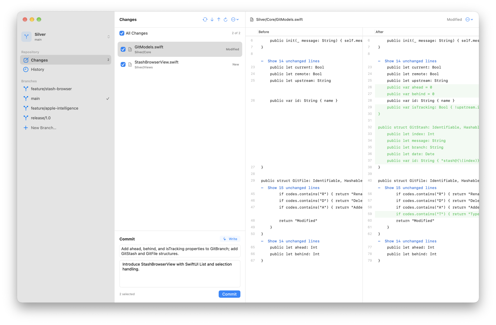
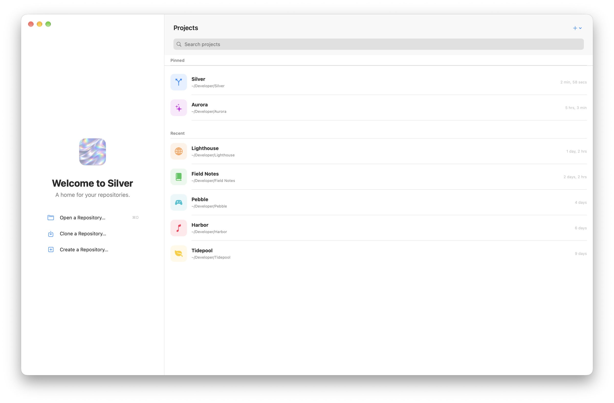
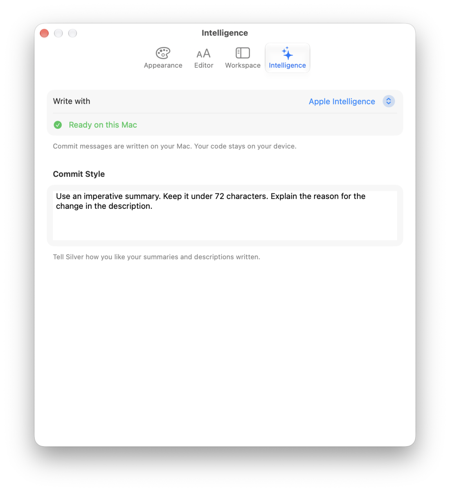
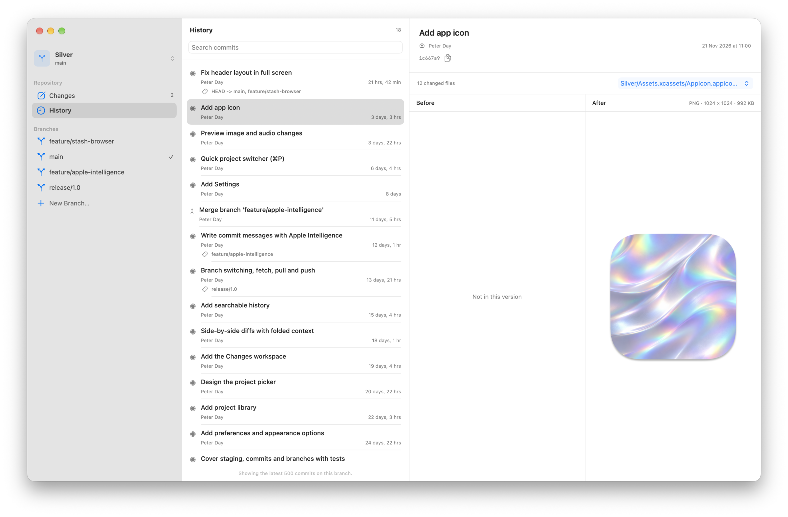
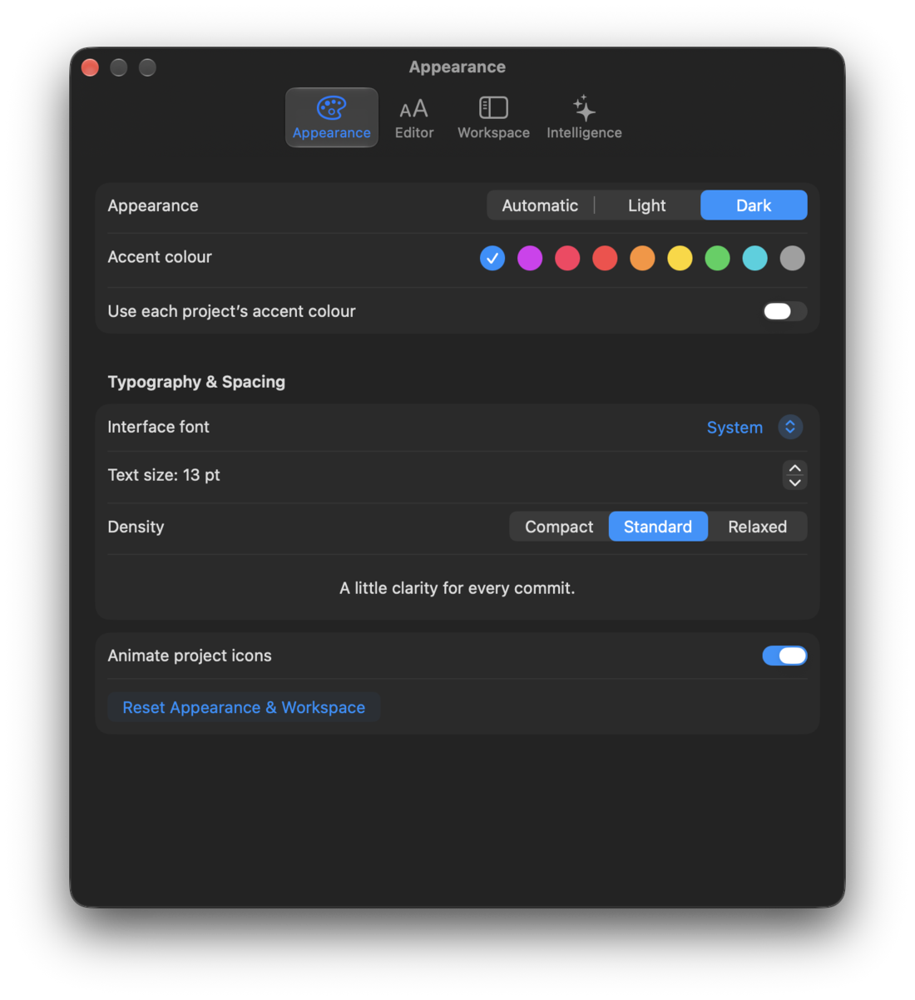

<div align="center">


# Silver

**A Git client that feels like it shipped with your Mac.**

Native SwiftUI. On-device Apple Intelligence. Nothing to configure.

<p>
  <a href="https://github.com/genericmilk/silver/releases/latest"></a>
  
  
  
</p>

<a href="https://github.com/genericmilk/silver/releases/latest"><b>Download Silver for Mac →</b></a>

<br><br>

<picture>
  <source media="(prefers-color-scheme: dark)" srcset="docs/images/changes-dark.png">
  <source media="(prefers-color-scheme: light)" srcset="docs/images/changes-light.png">
  
</picture>

</div>

<br>

## A home for your repositories

Silver opens to a project library, not an empty window. Pin the repositories you live in, and give each one a colour and an SF Symbol or your own image so you can spot it at a glance. Search with a few keystrokes and press Return. Press **⌘P** anywhere to jump to another project.

<picture>
  <source media="(prefers-color-scheme: dark)" srcset="docs/images/picker-dark.png">
  <source media="(prefers-color-scheme: light)" srcset="docs/images/picker-light.png">
  
</picture>

## Commit messages, written for you

Press **Write** and Silver drafts a summary and description from the files you've checked. By default it uses Apple Intelligence through the on-device Foundation Models framework, so **your code never leaves your Mac**. The draft is just a starting point: edit it, rewrite it, or ignore it.

You can switch to **Claude**, **OpenAI** or **OpenRouter** with your own API key if you like. Keys are stored in the macOS Keychain, and nothing is sent until you choose Write.

<p align="center">
  <picture>
    <source media="(prefers-color-scheme: dark)" srcset="docs/images/intelligence-dark.png">
    <source media="(prefers-color-scheme: light)" srcset="docs/images/intelligence-light.png">
    
  </picture>
</p>

## History you can actually read

Search the last 500 commits on any branch. Select one to see who made it, when, and every file it touched. Diffs come with line numbers, folded context and synchronised side-by-side scrolling. Images and audio show as real before and after previews, not "binary file changed".

<picture>
  <source media="(prefers-color-scheme: dark)" srcset="docs/images/history-dark.png">
  <source media="(prefers-color-scheme: light)" srcset="docs/images/history-light.png">
  
</picture>

## Everything you need, nothing you don't

<table>
<tr>
<td width="50%" valign="top">

### ✓ Changes
Every changed file starts checked. Uncheck what you don't want and commit. Silver leaves your staged and unstaged work exactly as it was. If you prefer, explicit staging is still there.

</td>
<td width="50%" valign="top">

### ⑂ Branches
Create, switch, fetch, pull and push. If uncommitted work blocks a switch, **Bring Changes** carries it to the new branch, and Silver keeps a backup if anything conflicts.

</td>
</tr>
<tr>
<td valign="top">

### ◐ Diffs
Inline or side-by-side, with aligned replacement rows, optional wrapping and context you expand inline. You never see raw hunk markers or hashes.

</td>
<td valign="top">

### ⌫ Safe discards
Discard one file or everything. The confirmation tells you exactly what will be lost, and new files go to the Trash rather than disappearing.

</td>
</tr>
<tr>
<td valign="top">

### Aa Make it yours
Light or dark, nine accent colours, interface and code fonts, density, diff palettes, line spacing. Every option sits in a standard Settings window.

</td>
<td valign="top">

### ⌘ Keyboard first
The actions you use most have shortcuts, including commit, refresh and switching projects. Silver follows the macOS conventions you already know, in a window or in full screen.

</td>
</tr>
</table>

<p align="center">
  
</p>

## Install

1. Download **Silver-1.0.0.dmg** from the [latest release](https://github.com/genericmilk/silver/releases/latest).
2. Open it and drag **Silver** to **Applications**.
3. Silver is ad-hoc signed rather than notarised, so macOS asks before the first launch. Open **System Settings → Privacy & Security** and click **Open Anyway**. Alternatively, run:

   ```sh
   xattr -dr com.apple.quarantine /Applications/Silver.app
   ```

**Requirements:** macOS 26 or later, on Apple silicon or Intel. Writing with Apple Intelligence needs a Mac that supports it, with Apple Intelligence turned on.

## Keyboard shortcuts

| Action | Shortcut |
| --- | --- |
| Open Repository | <kbd>⌘</kbd> <kbd>O</kbd> |
| Clone Repository | <kbd>⇧</kbd> <kbd>⌘</kbd> <kbd>O</kbd> |
| New Repository | <kbd>⌘</kbd> <kbd>N</kbd> |
| Switch Project | <kbd>⌘</kbd> <kbd>P</kbd> |
| Project Library | <kbd>⇧</kbd> <kbd>⌘</kbd> <kbd>L</kbd> |
| Commit | <kbd>⌘</kbd> <kbd>Return</kbd> |
| Refresh | <kbd>⌘</kbd> <kbd>R</kbd> |
| Toggle Sidebar | <kbd>⌥</kbd> <kbd>⌘</kbd> <kbd>S</kbd> |

## Privacy

- **No accounts, analytics or telemetry.**
- Silver runs `/usr/bin/git` directly with argument arrays and uses your existing credential helper or SSH keys. Configure authentication outside Silver, as you do for the command line.
- Apple Intelligence runs entirely on your Mac. A hosted provider receives a (possibly truncated) diff only when you press **Write** with that provider selected.
- Silver never commits, pushes or discards anything on its own.

## Build from source

Requires Xcode 26 or later.

```sh
git clone https://github.com/genericmilk/silver.git
cd silver
./scripts/build.sh        # builds a Debug copy and launches it
```

Or open `Silver.xcodeproj` and run the **Silver** scheme. `project.yml` is the [XcodeGen](https://github.com/yonaskolb/XcodeGen) source; after changing the project structure, run `xcodegen generate`. The checked-in project builds without XcodeGen.

### Tests

```sh
swift test
```

The tests use disposable local repositories and a local bare remote, so they need no network access or credentials. They cover commits with bodies, selected-file commits that leave excluded work alone, staging, literal filenames, branch switching with Bring Changes and conflict backups, failed-switch recovery, detached HEAD, rename detection, binary and media previews, diff alignment, cloning, fetching, pulling and pushing.

<details>
<summary><b>Implementation notes</b></summary>

<br>

- Silver is built with SwiftUI on macOS 26, with AppKit only where the system requires it, such as window chrome and the Dock icon.
- The app is not sandboxed because it runs Git against local paths, hooks and credentials. It uses the hardened runtime.
- Checking a file in Changes doesn't touch the Git index. Commit includes only the checked files and keeps excluded staged and unstaged changes intact.
- Merge commits are compared against their first parent.
- Imported project images are stored as small PNGs in Application Support, so moving the original doesn't break the icon.
- Provider requests follow the [Apple Foundation Models](https://developer.apple.com/documentation/foundationmodels/generating-content-and-performing-tasks-with-foundation-models), [Claude Messages](https://platform.claude.com/docs/en/api/messages/create), [OpenAI Chat Completions](https://developers.openai.com/api/reference/resources/chat/subresources/completions/methods/create) and [OpenRouter Chat Completions](https://openrouter.ai/docs/api/api-reference/chat/send-chat-completion-request) interfaces. Model identifiers can be edited in Settings, and long diffs are truncated to fit the model's context.
- Project icons get a short Core Animation spring on arrival and hover, which respects Reduce Motion.

</details>

<br>

<div align="center">
<sub>Made for the Mac, with care.</sub>
</div>
